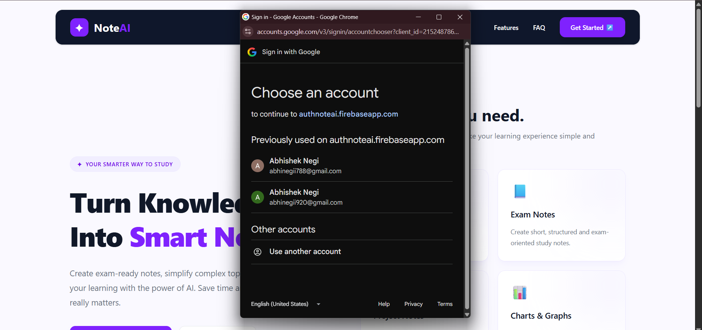
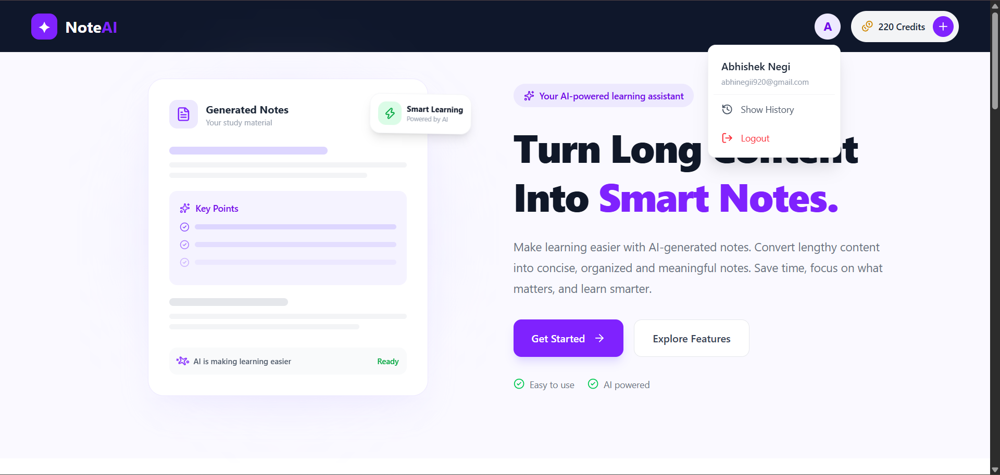
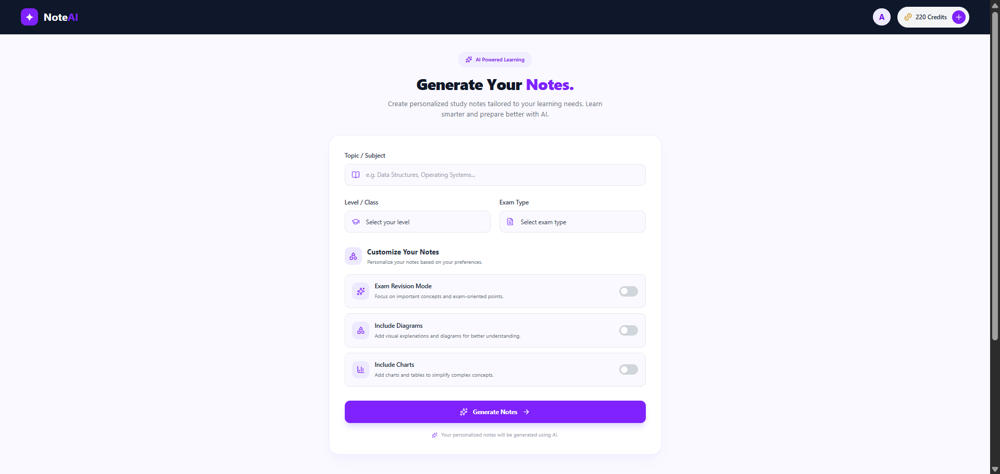
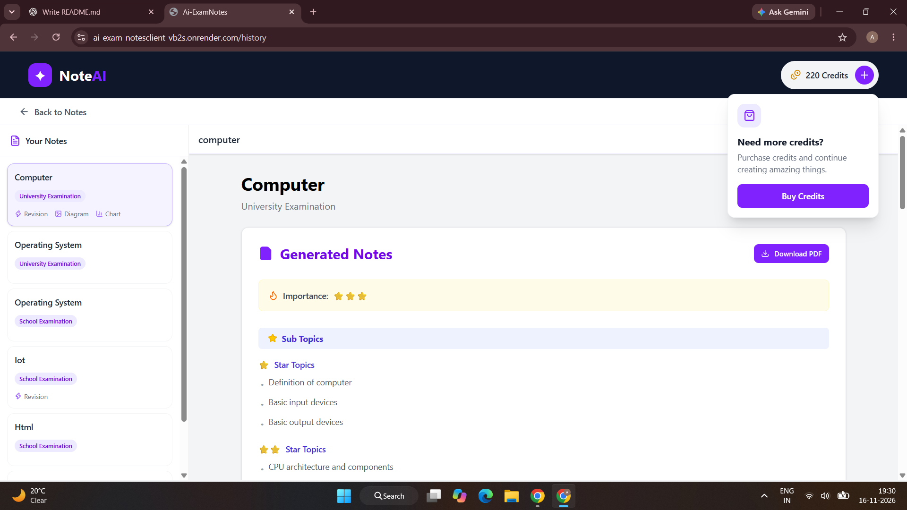
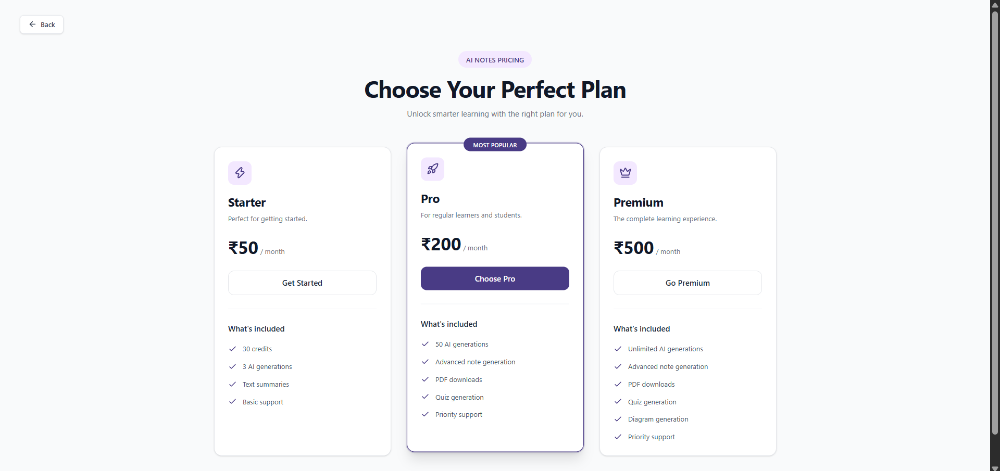

# AI Exam Notes 📚

AI Exam Notes is an AI-powered learning platform that helps students generate structured, exam-oriented study notes using artificial intelligence. Students can enter a topic, select their class level and exam type, and generate personalized notes with explanations, key concepts, summaries, diagrams, charts, and practice questions.

🚀 **Live Demo:** https://ai-exam-notesclient-vb2s.onrender.com/auth

## 📸 Screenshots

<!-- Add your project screenshots inside a screenshots folder -->

### Authentication


### Dashboard


### Note Form


### History


### Pricing


## ✨ Features

- **AI-Powered Note Generation:** Generate structured study notes based on topics, class levels, and exam types.
- **Personalized Learning:** Customize notes using revision mode and additional learning preferences.
- **Visual Learning:** Generate diagrams and charts to understand complex concepts.
- **Practice Questions:** Reinforce learning with AI-generated practice questions.
- **Note History:** Access previously generated notes anytime.
- **PDF Download:** Download generated notes for offline learning.
- **User Authentication:** Secure user registration and login.
- **Credit System:** Manage credits and track usage for AI note generation.
- **Payment Integration:** Purchase additional credits through Stripe.
- **Responsive UI:** Clean and responsive interface for a smooth learning experience.

## 🛠️ Tech Stack

**Frontend**
- React.js
- Tailwind CSS
- Redux Toolkit
- React Router
- Axios
- Motion
- React Markdown

**Backend**
- Node.js
- Express.js
- MongoDB
- Mongoose
- JWT Authentication

**AI & Integrations**
- Google Gemini API
- Stripe Payment Gateway

## ⚙️ Getting Started

Follow these steps to run the project locally.

### 1. Clone the Repository

```bash
git clone YOUR_GITHUB_REPOSITORY_URL
cd YOUR_PROJECT_FOLDER
```

### 2. Install Dependencies

Install frontend and backend dependencies:

```bash
# Frontend
cd client
npm install

# Backend
cd ../server
npm install
```

### 3. Environment Variables

Create `.env` files in the frontend and backend directories and configure the required environment variables.

**Backend `.env`:**

```env
PORT=5000
MONGODB_URI=your_mongodb_connection_string
JWT_SECRET=your_jwt_secret
GEMINI_API_KEY=your_gemini_api_key
CLIENT_URL=http://localhost:5173
STRIPE_SECRET_KEY=your_stripe_secret_key
```

Add any other environment variables required by your implementation.

**Frontend `.env`:**

```env
VITE_SERVER_URL=http://localhost:5000
```

### 4. Run the Application

Start the backend:

```bash
cd server
npm run dev
```

Start the frontend in another terminal:

```bash
cd client
npm run dev
```

Open the local development URL displayed by Vite in your browser.

## 🔄 How It Works

1. Register or log in to your account.
2. Enter the topic you want to study.
3. Select your class level and exam type.
4. Customize your learning preferences.
5. Generate notes using AI.
6. Explore explanations, key concepts, diagrams, summaries, and practice questions.
7. Save, revisit, or download your notes.

## 🔐 Security

- JWT-based authentication using HTTP-only cookies.
- Protected API routes.
- Server-side validation.
- Secure handling of API credentials and payment operations.

## 🎯 Project Objective

The goal of AI Exam Notes is to make exam preparation easier and more efficient by combining artificial intelligence with personalized learning. It helps students turn any study topic into organized, understandable, and exam-focused learning material.

---

**Developed with ❤️ using the MERN Stack and Google Gemini AI.**
